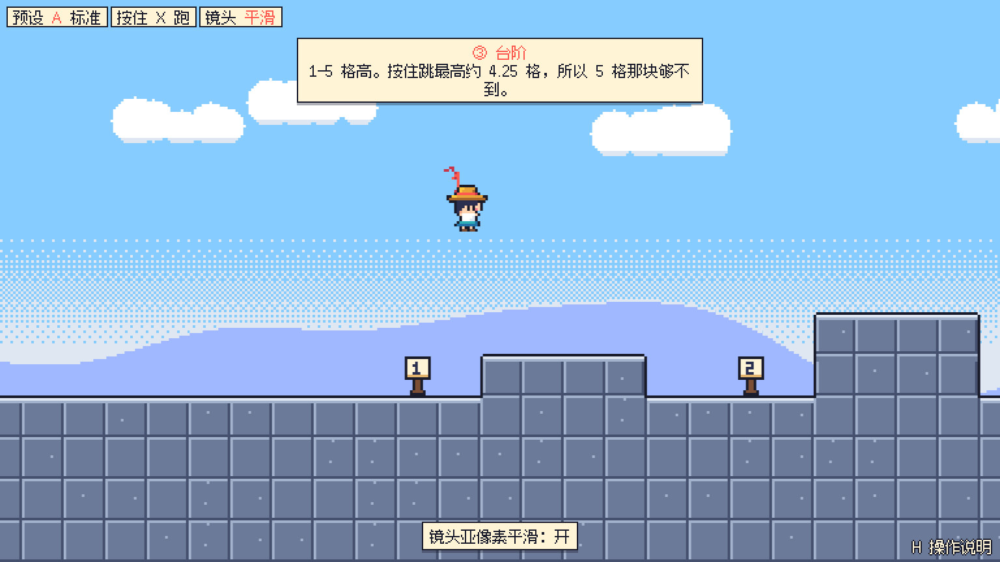

# 四时铃 · Pixel Isle

在浏览器里玩的原创像素风横版平台跳跃游戏。玩法是马里奥式的跑、跳、踩、顶，加上投掷装备、坐骑、冻住敌人滚雪球，以及一段海岛冒险故事。

- 总体计划：[PLAN.md](PLAN.md)
- 当前进度：**M0 手感测试关（练习场）**，详细计划见 [docs/levels/0-gym.md](docs/levels/0-gym.md)



## 在 Mac 上运行

需要 **Node.js 22.12 或更新版本**（推荐 24 LTS）。还没装的话，用 Homebrew 安装：

```bash
brew install node@24
```

装好后用 `node -v` 确认版本。然后：

```bash
git clone https://github.com/cqutairobot/pixel-isle.git   # 第一次才需要
cd pixel-isle
git fetch origin
git checkout claude/vigilant-dirac-asogye                 # 换成要试玩的分支
git pull
npm install
npm run dev
```

浏览器打开终端里显示的地址（默认 <http://localhost:5173>）。推荐用 Chrome，Safari 也支持。第一次按任意键后会有声音。

## 练习场操作

| 动作 | 键盘 | 手柄 |
|---|---|---|
| 移动 | ← → 或 A D | 左摇杆 / 十字键 |
| 下蹲（往下看）/ 抬头（往上看） | ↓ / ↑ 或 S / W | 下 / 上 |
| 跳（按住跳得更高） | Z、空格 或 K | A |
| 跑（按住） | X 或 J | X |
| 下穿单向平台 | ↓ + 跳 | 下 + A |

练习场专用键（Mac 的 F 键默认是亮度、音量键，所以主要用字母和数字键）：

| 键 | 功能 |
|---|---|
| 1 / 2 / 3 | 切换手感预设 A 标准 / B 轻快 / C 厚重 |
| 4 | 自动奔跑 开 / 关 |
| 5 | 镜头亚像素平滑 开 / 关 |
| Q / E | 传送到上一个 / 下一个站点 |
| R | 回到起点 |
| H | 显示 / 隐藏操作说明 |
| M | 静音 |
| \`（Esc 下面的键）或 F1 | 调试叠加层（碰撞盒、速度、计时条、跳跃轨迹、网格） |
| T 或 F2 | 调参面板（可以"复制参数 JSON"发给 Claude） |
| G 或 F4 | 慢放 1 → ½ → ¼ |
| P 或 Esc | 暂停；暂停时按 N 逐帧前进 |

其他页面：

- 试听板：<http://localhost:5173/?scene=soundboard>，逐个试听音效候选并选定，选择会立即用在练习场。
- 指定预设或站点：`?preset=B`、`?station=3`。
- 对比渲染方式：`?render=round`（取整像素；默认是平滑像素）。

## 开发命令

| 命令 | 作用 |
|---|---|
| `npm run dev` | 开发服务器（改代码后浏览器自动刷新） |
| `npm run build` | 类型检查 + 打包到 `dist/` |
| `npm run preview` | 预览打包结果 |
| `npm run typecheck` | 只做类型检查 |
| `npm test` | 单元测试（物理、手感规则、关卡校验） |
| `npm run test:e2e` | 浏览器冒烟测试（Mac 上第一次运行前先执行 `npx playwright install chromium`） |
| `npm run preview-art` | 把精灵渲染成放大的 PNG（默认输出到 `docs/art/`） |
| `npx tsx scripts/jump-metrics.ts` | 打印各手感预设的跳跃高度与距离 |
| `npm run analyze-sfx` | 分析音效候选的时长、响度、音高 |

## 目录结构

```
src/sim/       纯逻辑：物理、主角、镜头、关卡解析（不依赖 Phaser，可在 Node 里测试）
src/view/      表现层：精灵、帽带、粒子、震屏、视差背景、动效
src/art/       代码绘制的像素美术：调色板、精灵网格、地形规则、程序化背景
src/audio/     音效合成（ZzFX）、音频引擎、试听板
src/content/   关卡与文本
src/ui/        界面（练习场用 DOM 叠加层）
src/debug/     调试叠加层、调参面板
src/scenes/    Phaser 场景
tests/ e2e/    单元测试与浏览器测试
docs/          每关详细计划、美术截图
```

## 致谢与许可

- 游戏引擎 [Phaser](https://phaser.io)（MIT）
- 音效合成移植自 [ZzFX](https://github.com/KilledByAPixel/ZzFX)（MIT，Frank Force）
- 界面字体 [缝合像素字体 Fusion Pixel Font](https://github.com/TakWolf/fusion-pixel-font)（SIL OFL 1.1，许可证见 `public/licenses/`）
- 调参面板 [lil-gui](https://lil-gui.georgealways.com)（MIT）
- 角色、美术、音效、故事均为本作原创
