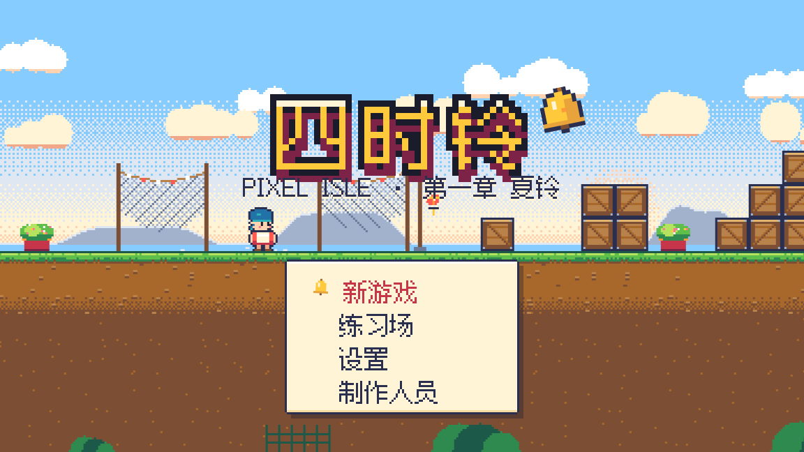
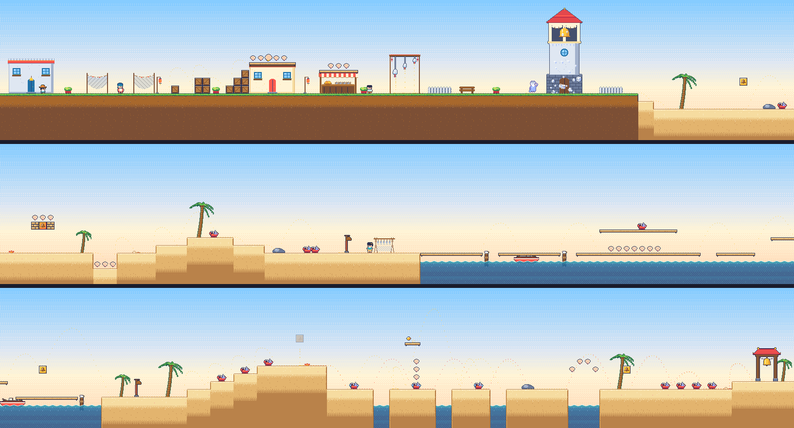
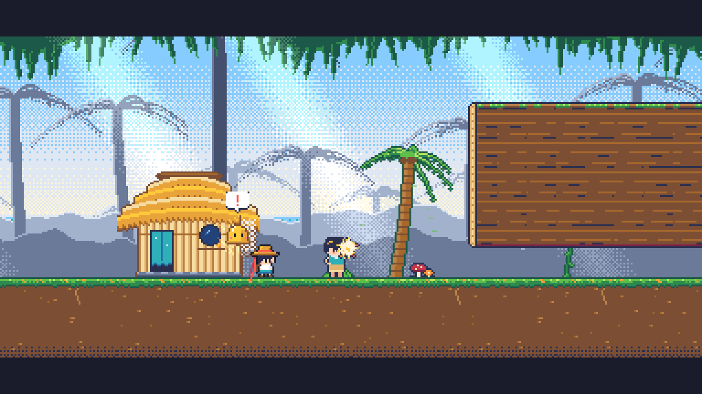
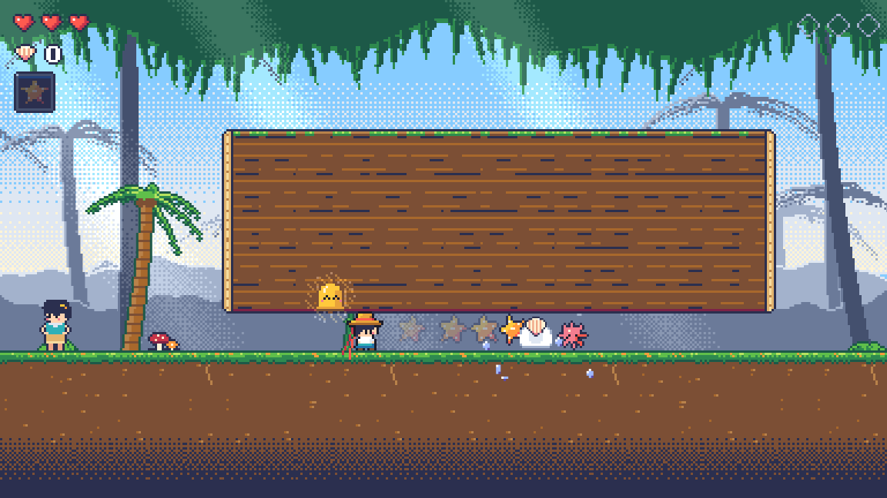
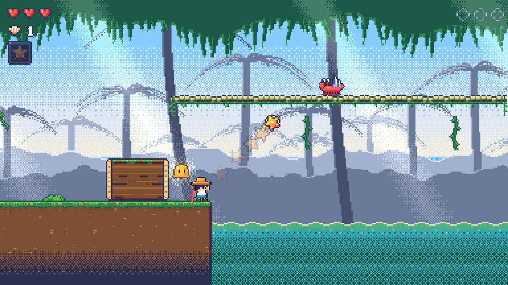
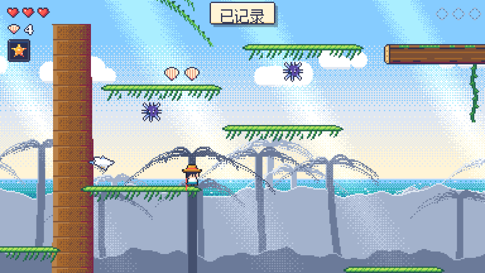
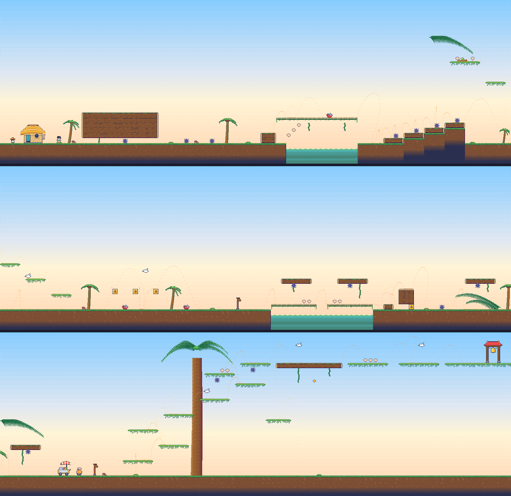

# 四时铃 · Pixel Isle

在浏览器里玩的原创像素风横版平台跳跃游戏。玩法是马里奥式的跑、跳、踩、顶，加上投掷装备、坐骑、冻住敌人滚雪球，以及一段海岛冒险故事。

- 总体计划：[PLAN.md](PLAN.md)
- 当前进度：**M1 第 1 关「晨钟村 · 晨光沙滩」已通过**（计划见 [docs/levels/1-1.md](docs/levels/1-1.md)）。**M2-a 第 2 关「椰影小径」的玩法部分可以试玩了**：回旋海星、刺海胆、冰喙鸥、椰林、1-2 整关（计划见 [docs/levels/1-2.md](docs/levels/1-2.md)）。章节地图、获得道具演出、1-2 的音乐在 M2-b。
- 练习场（M0）的计划见 [docs/levels/0-gym.md](docs/levels/0-gym.md)





| | |
|---|---|
|  |  |
|  |  |



## 在线试玩（不用安装）

**<https://claude.ai/artifact/B14NuTU4u23E5HA1LDHeuB>**

- 每次交付新内容，都会更新到这个链接。
- 链接默认只有仓库所有者能打开；想给别人玩，在页面的分享菜单里开启分享。
- 页面打开后，先用鼠标点一下画面，键盘才能控制。需要电脑键盘或手柄，手机上不能玩。
- 打开是标题画面：按任意键 → 新游戏（序章 → 第 1 关）。
- 在链接后面加 `#1-1` 直接进第 1 关，`#1-2` 直接进第 2 关，`#prologue` 看序章，`#gym` 进练习场，`#soundboard` 打开试听板（可以试听音乐和音效）。
- 第 1 关结算时选"继续"会进第 2 关；标题画面的"继续"在通关过第 1 关以后也会进第 2 关（章节地图做好以前先这样）。

## 在 Mac 上本地运行

需要 **Node.js 22.12 或更新版本**（推荐 24 LTS）。还没装的话，用 Homebrew 安装：

```bash
brew install node@24
```

装好后用 `node -v` 确认版本。然后：

```bash
git clone https://github.com/cqutairobot/pixel-isle.git   # 第一次才需要
cd pixel-isle
git fetch origin
git checkout claude/vigilant-dirac-asogye                 # 换成要试玩的分支
git pull
npm install
npm run dev
```

浏览器打开终端里显示的地址（默认 <http://localhost:5173>，是标题画面；直接进第 1 关是 <http://localhost:5173/#1-1>，第 2 关是 <http://localhost:5173/#1-2>，练习场是 <http://localhost:5173/#gym>）。推荐用 Chrome，Safari 也支持。第一次按任意键后会有声音。

## 操作

| 动作 | 键盘 | 手柄 |
|---|---|---|
| 移动（按住不放约 0.3 秒会加速成跑） | A D 或 ← → | 左摇杆 / 十字键 |
| 下蹲（往下看）/ 抬头（往上看） | S / W 或 ↓ / ↑ | 下 / 上 |
| 跳（按住跳得更高） | K、空格 或 Z | A |
| 扔回旋海星（第 2 关开场借到；按住 W / ↑ 斜着往上扔） | J 或 X | X |
| 切换装备 / 下坐骑（之后的关卡） | L 或 C | Y |
| 下穿单向平台 | ↓ + 跳 | 下 + A |
| 和村民交谈（靠近时头顶出现 ↑） | W 或 ↑ | 上 |
| 对话翻页（正在打字时先显示整句） | K、空格、J 或 Enter | A |
| 跳过过场 | 长按 Esc 1 秒 | 长按 Start |
| 暂停菜单（暂停时按 R 重新开始本关） | Esc、Enter 或 P | Start |
| 菜单：选择 / 确认 / 返回 | W S 或 ↑ ↓ / K 或 Enter / J 或 Esc | 十字键 / A / B |

设置（标题菜单或暂停菜单里）：总音量、音乐、音效、震屏强度、减少闪烁、自动奔跑、辅助模式（心 +2）、全屏、操作说明、清除存档。

关卡里的开发用键：\`（Esc 下面的键）调试叠加层 · G 慢放 · 暂停时 N 逐帧 · Shift+1 / Shift+2 从第 1 / 第 2 个检查点开始。
本地运行时还可以用网址参数：`?cp=2`（从第 2 个检查点开始）、`?level=1-2`、`?intro=0`（不播放开场过场）。练习场里按 Backspace 回到标题。

练习场专用键（Mac 的 F 键默认是亮度、音量键，所以主要用字母和数字键）：

| 键 | 功能 |
|---|---|
| 1 / 2 / 3 | 切换手感预设 A 标准 / B 轻快 / C 厚重 |
| 4 | 自动奔跑 开 / 关（开启后一动就是跑） |
| 5 | 镜头亚像素平滑 开 / 关 |
| Q / E | 传送到上一个 / 下一个站点 |
| R | 回到起点 |
| H | 显示 / 隐藏操作说明 |
| M | 静音 |
| Y | 打开试听板（挑选音效） |
| \`（Esc 下面的键）或 F1 | 调试叠加层（碰撞盒、速度、计时条、跳跃轨迹、网格） |
| T 或 F2 | 调参面板（可以"复制参数 JSON"发给 Claude） |
| G 或 F4 | 慢放 1 → ½ → ¼ |
| P 或 Esc | 暂停；暂停时按 N 逐帧前进 |

其他页面：

- 试听板：在练习场里按 Y，或打开 <http://localhost:5173/#soundboard>。上面是音乐（4 首曲子、4 个乐句、2 种环境声），下面逐个试听音效候选并选定，选择会立即生效。
- 指定预设或站点：`?preset=B`、`?station=3`。
- 对比渲染方式：`?render=round`（取整像素；默认是平滑像素）。

## 开发命令

| 命令 | 作用 |
|---|---|
| `npm run dev` | 开发服务器（改代码后浏览器自动刷新） |
| `npm run build` | 类型检查 + 打包到 `dist/` |
| `npm run build:artifact` | 生成在线试玩页要发布的文件（`dist-artifact/page/`） |
| `npm run preview` | 预览打包结果 |
| `npm run typecheck` | 只做类型检查 |
| `npm test` | 单元测试（物理、手感规则、关卡校验） |
| `npm run test:e2e` | 浏览器冒烟测试（Mac 上第一次运行前先执行 `npx playwright install chromium`） |
| `npm run preview-art` | 把精灵渲染成放大的 PNG（默认输出到 `docs/art/`） |
| `npx tsx scripts/jump-metrics.ts` | 打印各手感预设的跳跃高度与距离 |
| `npm run analyze-sfx` | 分析音效候选的时长、响度、音高 |
| `npm run overview` | 生成整关总览图（`docs/levels/img/1-1.png`，叠加回放轨迹） |
| `npm run replays` | 用"自动玩家"重新录制回放（`tests/replays/`；改了关卡导致回放测试失败时用） |
| `npx tsx scripts/preview-sprites.ts 输出.png enemy/,item/` | 按名字前缀把精灵渲染成放大的 PNG |

## 目录结构

```
src/sim/       纯逻辑：物理、主角、敌人、方块、道具、生命与检查点、镜头、关卡解析、回放（不依赖 Phaser）
src/view/      表现层：精灵、帽带、粒子、震屏、视差背景（含夜晚版）、动效
src/art/       代码绘制的像素美术：调色板、精灵网格与画笔、地形规则、程序化背景、对话头像
src/audio/     音效合成（ZzFX）、音频引擎、试听板
src/audio/music/  纯 TS 音乐合成器、音序器、乐谱、环境声、播放器
src/content/   关卡、对白、过场分镜、说话人与界面文字（所有显示的文字都在这里）
src/ui/        画布界面：像素文字、HUD、对话框、菜单、设置、暂停、转场、结算（练习场仍用 DOM 叠加层）
src/platform/  显示缩放、键盘手柄输入、存档、设置
src/debug/     调试叠加层、调参面板
src/scenes/    Phaser 场景（启动、标题、练习场、关卡、界面）与过场导演
tests/ e2e/    单元测试（含关卡校验、回放通关）与浏览器测试
docs/          每关详细计划、关卡总览图、美术截图
```

## 致谢与许可

- 游戏引擎 [Phaser](https://phaser.io)（MIT）
- 音效合成移植自 [ZzFX](https://github.com/KilledByAPixel/ZzFX)（MIT，Frank Force）
- 界面字体 [缝合像素字体 Fusion Pixel Font](https://github.com/TakWolf/fusion-pixel-font)（SIL OFL 1.1，许可证见 `public/licenses/`）
- 调参面板 [lil-gui](https://lil-gui.georgealways.com)（MIT）
- 角色、美术、音效、故事均为本作原创
